<div align="center">


# BenHeimdall

**O guardião do salão.** Painel em tempo real do call center da Benconsig: quem está atendendo,
tabulando, em pausa e livre para transferência, numa única tela que se atualiza sozinha.

<p>
  
  
  
  
  
  
  
  
</p>

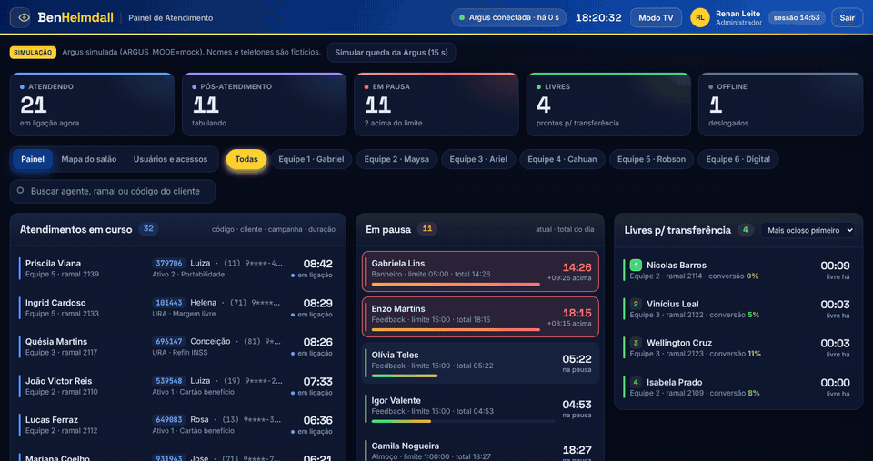

<sub>Simulação com dados fictícios: cronômetros ao vivo, pausa estourada pulsando e uma queda da Argus que volta sozinha.</sub>

<p>
  <a href="#-começo-rápido">Começo rápido</a> ·
  <a href="#-telas">Telas</a> ·
  <a href="#-ligar-na-argus-real">Argus real</a> ·
  <a href="#-equipes">Equipes</a> ·
  <a href="#-acesso-e-segurança">Acesso</a> ·
  <a href="#-produção">Produção</a> ·
  <a href="#-arquitetura">Arquitetura</a>
</p>

</div>

---

## ✨ O que o painel mostra

|                                  |                                                                                                                                    |
| -------------------------------- | ---------------------------------------------------------------------------------------------------------------------------------- |
| 📞 **Atendimentos em curso**     | Agente, código do cliente, primeiro nome, telefone parcial, campanha e duração. Quem está tabulando aparece como **Tabulando**.    |
| ⏸️ **Em pausa**                  | Motivo, tempo na pausa, limite do motivo e total do dia. O cartão fica **laranja a 80%** do limite e **vermelho pulsante a 100%**. |
| ✅ **Livres para transferência** | Há quanto tempo estão livres, em ordem de **mais ocioso** ou de **melhor conversão**.                                              |
| 📊 **Indicadores**               | Atendendo, pós-atendimento, em pausa (e quantos acima do limite), livres e offline.                                                |
| 🗺️ **Mapa do salão**             | As 6 equipes com 8 baias cada; a baia 1 de cada lado fica junto da mesa do supervisor.                                             |
| 🕒 **Detalhe do agente**         | Linha do tempo do dia, atendimentos, vendas e pausa total.                                                                         |
| 📺 **Modo TV**                   | Tela cheia, letras grandes, sem dados de cliente e sem motivo de pausa.                                                            |

> [!NOTE]
> O painel **só lê dados**, com uma exceção: o botão **Transferir ligação**, no detalhe de quem
> está em ligação. Ele abre a tela de transferência da Argus no computador do operador (comando
> `popuptransferencia`, doc 4.15). A API não transfere direto para um ramal: o operador escolhe o
> destino, e o painel mostra quem está livre para indicar. Admin transfere em todas as equipes;
> supervisor, só na própria. Cada pedido fica no log de acessos. O painel não pausa nem desloga ninguém.

## 🖼️ Telas

<table>
  <tr>
    <td width="50%">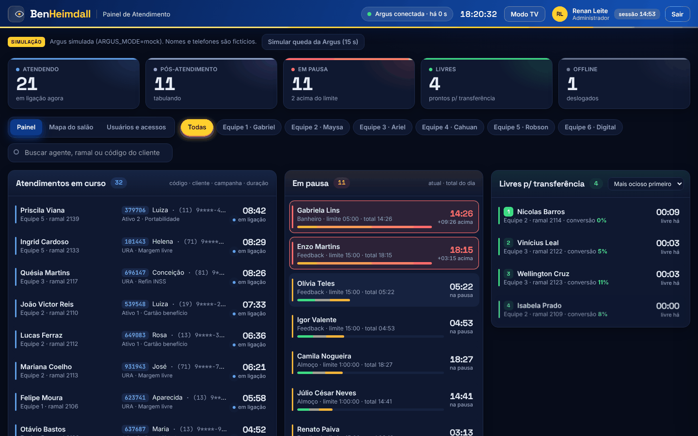<br /><sub><b>Painel</b> · tema escuro</sub></td>
    <td width="50%">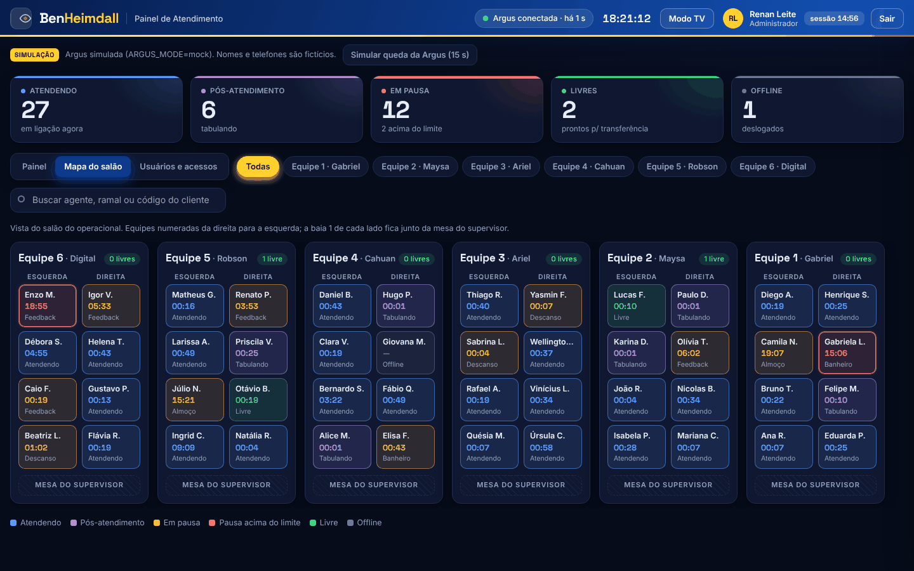<br /><sub><b>Mapa do salão</b> · 6 equipes × 8 baias</sub></td>
  </tr>
  <tr>
    <td width="50%">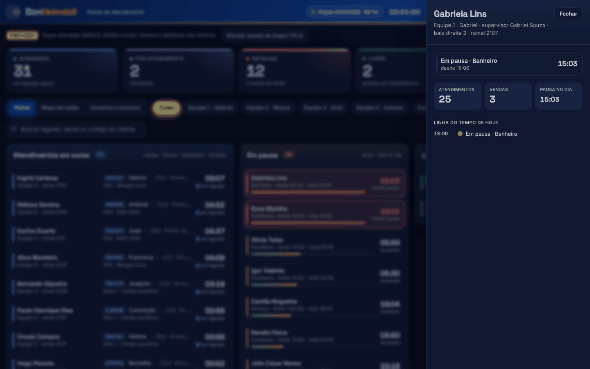<br /><sub><b>Detalhe do agente</b> · linha do tempo do dia</sub></td>
    <td width="50%">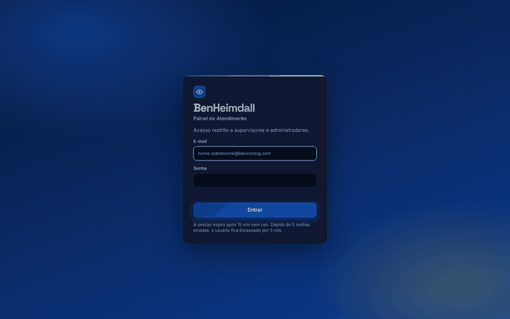<br /><sub><b>Login</b> · por e-mail</sub></td>
  </tr>
</table>

<details>
<summary><b>Mais telas: tema claro, usuários e modo TV</b></summary>
<br />

| Tema claro                                                         | Usuários e acessos                                                                             |
| ------------------------------------------------------------------ | ---------------------------------------------------------------------------------------------- |
| 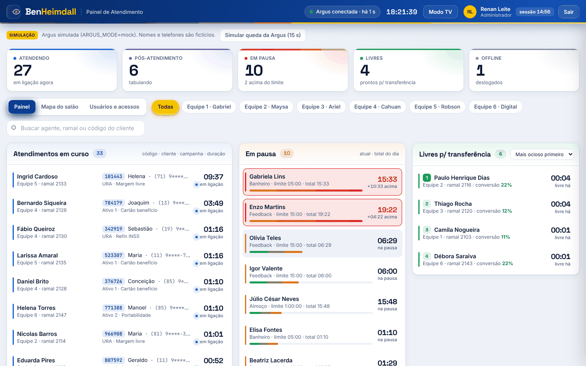 | 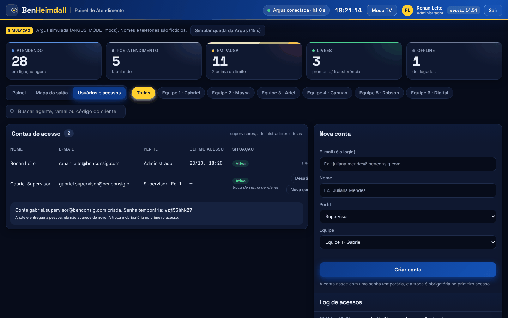 |

**Modo TV (1080p)**

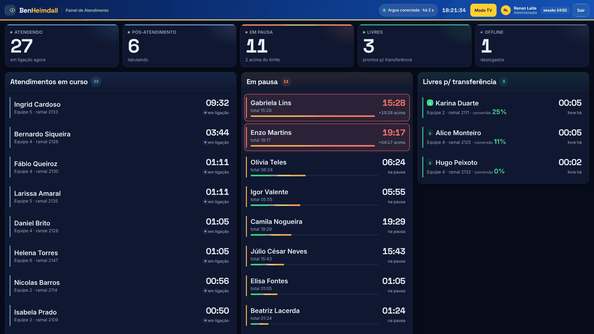

</details>

## 🚀 Começo rápido

Você precisa do **Node.js 20 ou mais novo** (recomendado: 22 LTS). O npm já vem junto.

```bash
cp .env.example .env
```

```bash
npm install
```

```bash
npm run dev
```

Abra **<http://localhost:5180>**: no seu PC o painel **abre direto, sem login**, como administrador
(selo **acesso livre · PC** no topo). Por padrão, roda com a **Argus simulada**.

> [!NOTE]
> O acesso livre só vale com `NODE_ENV=development`. No servidor (`NODE_ENV=production`, forçado
> pelo PM2 e pelo Docker) o login volta: entre com **`renan.leite@benconsig.com`** /
> **`troque-no-primeiro-acesso`** e crie a senha nova. Para testar o login no PC, ponha
> `LOGIN_EM_DEV=true` no `.env`.

> [!TIP]
> Para ver o aviso de queda, clique em **Simular queda da Argus (15 s)** no topo do painel: o
> aviso aparece e a conexão volta sozinha.

<details>
<summary><b>🪟 Passo a passo no Windows (PowerShell)</b></summary>
<br />

1. Instale o Node.js LTS, se `node -v` não responder, e feche e abra o PowerShell depois:

   ```powershell
   winget install OpenJS.NodeJS.LTS
   ```

2. Entre na pasta e copie o modelo de configuração:

   ```powershell
   cd C:\BenHeimdall
   ```

   ```powershell
   Copy-Item .env.example .env
   ```

3. Instale e suba:

   ```powershell
   npm install
   ```

   ```powershell
   npm run dev
   ```

**Problemas comuns**

- **"A execução de scripts foi desabilitada neste sistema":** libere os scripts só para o seu usuário.

  ```powershell
  Set-ExecutionPolicy -Scope CurrentUser RemoteSigned
  ```

- **O login com o e-mail não funciona:** o primeiro admin só é criado com o banco vazio. Se o
  sistema já tinha subido antes, apague o banco de teste e suba de novo.

  ```powershell
  Remove-Item -Recurse -Force data
  ```

- **O `.env` parece vazio:** confira se abriu o **`.env`** (com ponto), e não um arquivo novo chamado `env`.

</details>

<details>
<summary><b>🔗 Mostrar para outra pessoa sem publicar nada</b></summary>
<br />

Com o [`cloudflared`](https://developers.cloudflare.com/cloudflare-one/connections/connect-networks/downloads/)
instalado (`winget install Cloudflare.cloudflared`) e o `npm run dev` no ar, rode em outro terminal:

```powershell
npm run dev:tunel
```

Ele mostra um endereço `https://<algo>.trycloudflare.com` temporário. Só entra quem estiver nos
IPs de `IPS_PERMITIDOS`, e o endereço muda a cada execução.

</details>

## 🔌 Ligar na Argus real

No `.env`, troque o modo e coloque o token da Argus (**Configurações → Desenvolvedor → Acesso API**):

```ini
ARGUS_MODE=real
ARGUS_TOKEN=<token da Argus>
```

Reinicie e confira em <http://localhost:3020/health>: `"modo":"real","online":true`. Se a Argus não
responder, o painel mostra o aviso de queda e tenta de novo sozinho; o motivo aparece em
`argus.ultimoErro` (por exemplo, token recusado).

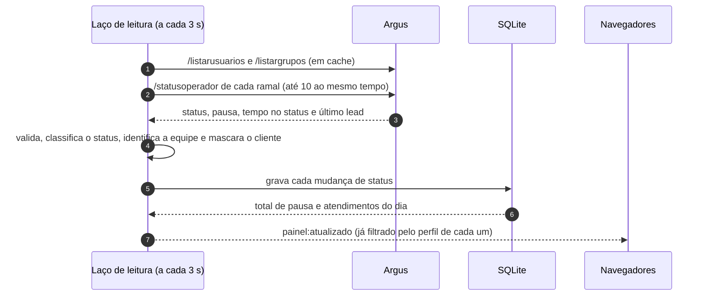

| O painel mostra                 | De onde vem (doc-api-argus.pdf)                                                              |
| ------------------------------- | -------------------------------------------------------------------------------------------- |
| Agentes (nome, ramal)           | `/listarusuarios` (operadores ativos), em cache de 5 min                                     |
| Robôs fora do painel            | `/listargrupos`: ramais de grupos virtuais (DTMF/Flash) são ignorados                        |
| Status, pausa e tempo no status | `/statusoperador` de cada ramal, a cada `POLL_MS` (3 s)                                      |
| Cliente em atendimento          | `ultimoLead`: código, primeiro nome e telefone parcial. **O CPF que vem junto é descartado** |
| Equipe                          | grupo do operador e, se ele não disser, o supervisor (veja [Equipes](#-equipes))             |
| Atendimentos do dia             | contados pelo histórico do próprio BenHeimdall                                               |

<details>
<summary><b>Como cada status da Argus vira status do painel</b></summary>
<br />

| Na Argus (`descricaoStatus`)                           | No painel          |
| ------------------------------------------------------ | ------------------ |
| `Em Atendimento`, `Atendimento`, `Falando`, `Conversa` | 📞 Atendendo       |
| `Tabulando`, `Tabulação`, `Pós atendimento`            | 📝 Pós-atendimento |
| qualquer status com pausa (`descricaoPausa`)           | ⏸️ Em pausa        |
| `Livre`, `Disponível`                                  | ✅ Livre           |
| `Deslogado` ou não logado (a Argus responde HTTP 500)  | ⚫ Offline         |

Os textos ficam no `.env` (`STATUS_LIVRE`, `STATUS_ATENDIMENTO`, `STATUS_POS_ATENDIMENTO`,
`STATUS_OFFLINE`). Um texto desconhecido aparece **uma vez** no log ("Status desconhecido da
Argus"): é só acrescentá-lo na lista certa.

**Limites de pausa** (`config/pausas.json`): Almoço 60 min, Descanso 10, Banheiro 5 e Feedback 15.
O nome casa pelo início, sem diferenciar maiúsculas e acentos: "ALMOÇO 1" usa o limite de Almoço.

**Limite de requisições:** se a Argus responder 429, as leituras pausam alguns segundos e voltam
sozinhas. Se um ramal falhar pontualmente, o painel mantém o último status dele por até 30 s.

</details>

## 👥 Equipes

|  Nº   | Equipe  |     |  Nº   | Equipe      |
| :---: | ------- | --- | :---: | ----------- |
| **1** | Gabriel |     | **4** | Cahuan      |
| **2** | Maysa   |     | **5** | Robson      |
| **3** | Ariel   |     | **6** | **Digital** |

As equipes ficam em [`config/equipes.json`](config/equipes.json). O nome é procurado como palavra
inteira (sem diferenciar maiúsculas e acentos):

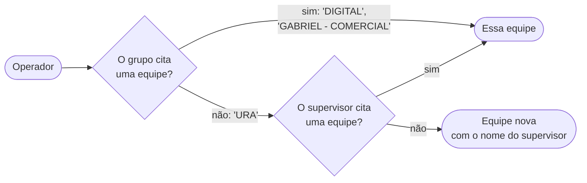

- **"Gabriel" não casa com "Gabriela".**
- **Rodízio:** quem está no grupo da URA continua na equipe do seu supervisor.
- **Baias:** as 8 baias de cada equipe são distribuídas por ordem de ramal. Equipe com mais de 8
  agentes mostra os demais em "Sem baia definida".
- As contas de supervisor do BenHeimdall usam esses números. O cadastro já mostra "Equipe 6 · Digital".

## 🔐 Acesso e segurança

| Perfil            | Vê                                                                                      | Sessão                                                 |
| ----------------- | --------------------------------------------------------------------------------------- | ------------------------------------------------------ |
| 🛡️ **admin**      | Tudo, mais a tela **Usuários e acessos**                                                | Expira após 15 min sem uso                             |
| 👤 **supervisor** | Status de todas as equipes; código, nome e telefone do cliente **só da própria equipe** | Expira após 15 min sem uso                             |
| 📺 **tv**         | Sem dados de cliente e sem motivo de pausa; entra direto no modo TV                     | Não expira, mas só entra pelos IPs de `TV_ALLOWED_IPS` |

- **Login por e-mail** em todas as contas, sem diferenciar maiúsculas. O nome é sugerido a partir
  do e-mail (`juliana.mendes@…` → "Juliana Mendes").
- Senhas com **bcrypt**; sessão em cookie **httpOnly + SameSite=Strict** (e **Secure** em produção).
- **5 senhas erradas** bloqueiam a conta por **5 min**. Conta nova e senha redefinida exigem **troca no primeiro acesso**.
- Contas são **desativadas, nunca apagadas**. Desativar ou gerar senha nova derruba as sessões abertas.
- O **log de acessos** registra entrada, saída, expiração, recusas, bloqueios e toda alteração de conta.

> [!IMPORTANT]
> A filtragem por perfil é feita **no servidor**, antes de enviar. CPF, benefício e conta
> **nunca** saem do backend; o telefone sai como `(11) 9****-1234` e o cliente só pelo primeiro nome.

<details>
<summary><b>🌐 Restrição por IP</b></summary>
<br />

Só os endereços de `IPS_PERMITIDOS` acessam o sistema: páginas, API e tempo real. Os demais
recebem `403`, e o primeiro acesso de cada IP recusado vai para o log. A lista vem com os IPs da
operação:

```text
2804:431:80f7:7700::/48   2804:1b3:a5e7:c3c7::/48   201.93.163.133
2804:1b3:a5e7:2c83::/48   201.93.159.169            2804:1b3:a5e7:8e38::/48
```

- Aceita IPv4, IPv6 e faixas CIDR. Um valor inválido impede o sistema de subir, em vez de liberar geral.
- A própria máquina (`127.0.0.1` e `::1`) sempre entra.
- Atrás do Cloudflare, vale o IP do visitante, desde que `TRUST_PROXY` esteja certo (o padrão
  `loopback` serve quando o `cloudflared` roda na mesma máquina).
- Em `npm run dev`, a lista protege API e tempo real. A casca da página (sem dados) vem do Vite.

</details>

## 🏭 Produção

<details>
<summary><b>🪟 Servidor Windows com PM2 (recomendado)</b></summary>
<br />

Mesmo modelo do BenURA: PM2 instalado no próprio projeto, uma tarefa no **Agendador de Tarefas**
que sobe tudo ao ligar o PC (mesmo sem ninguém logado) e um **vigia** a cada 5 min. No PowerShell
**como administrador**, na pasta do BenHeimdall:

1. Instale as dependências:

   ```powershell
   npm ci
   ```

2. Copie e revise o `.env` (`NODE_ENV=production`, `ARGUS_MODE=real`, `ARGUS_TOKEN`, `ADMIN_SENHA_INICIAL`, `TV_ALLOWED_IPS`):

   ```powershell
   Copy-Item .env.example .env
   ```

   ```powershell
   notepad .env
   ```

3. Instale o serviço. Ele compila, sobe no PM2, troca o `SESSION_SECRET` do exemplo por um
   aleatório e cria a tarefa "BenHeimdall" (pede a senha do usuário do Windows):

   ```powershell
   npm run servico:instalar
   ```

4. Confira (tarefa, PM2, `/health` e túnel):

   ```powershell
   npm run servico:verificar
   ```

**Atualizar:** `npm run atualizar:servidor` (para no PM2, `git pull`, `npm install`, compila e sobe de novo; o `.env` e o banco ficam).
**Logs:** `npm run pm2:logs`, `logs\benheimdall.out.log` e `logs\servico-windows.log` (vigia).

- **Uma única instância, em modo fork:** há um só laço de leitura da Argus, e o tempo real guarda as conexões em memória.
- **No mesmo servidor do BenURA:** os dois são independentes. Usam portas diferentes (BenHeimdall
  3020; BenURA 3000 a 3010) e, mesmo usando o mesmo PM2, os scripts daqui só mexem no processo
  `benheimdall` (nunca `pm2 delete all`).
- **Servidor Linux:** `npm run pm2:iniciar`, depois `npx pm2 save` e `npx pm2 startup`.

</details>

<details>
<summary><b>☁️ Publicação no Cloudflare (Tunnel)</b></summary>
<br />

O BenHeimdall precisa de um processo contínuo, de SQLite e de WebSocket, então **não roda no
Cloudflare Pages nem em Workers**. O caminho é o **Cloudflare Tunnel**: o `cloudflared`, no
servidor, publica o sistema com HTTPS **sem abrir porta** no roteador.

1. No PowerShell como administrador:

   ```powershell
   npm run tunel:instalar
   ```

   Cada PC tem **um** serviço `cloudflared`. Se já houver um (por exemplo, o do BenURA), o script
   não troca nada (só com `-Substituir`) e mostra o que fazer no painel; o BenHeimdall entra como
   mais um endereço no mesmo túnel.

2. No **Cloudflare Zero Trust → Networks → Tunnels → (o túnel) → Public Hostname**, adicione
   `heimdall.benconsig.com.br` (sugestão) → **HTTP** `localhost:3020`. O WebSocket já vem ligado.

3. No `.env`, use `NODE_ENV=production` e `TRUST_PROXY=loopback` (o padrão).

> [!TIP]
> Como camada extra, crie uma regra de WAF na Cloudflare liberando só os IPs de `IPS_PERMITIDOS`
> (ou use o Cloudflare Access). Assim o tráfego de fora nem chega ao servidor.

O IP da Tela TV, visto pela Cloudflare, é o **IP público da rede** de onde a TV sai. Esse é o IP
que vai em `TV_ALLOWED_IPS`.

</details>

<details>
<summary><b>🐳 Docker (imagem endurecida)</b></summary>
<br />

```bash
docker compose up -d --build
```

Com o túnel da Cloudflare junto (e `CLOUDFLARE_TUNNEL_TOKEN` e `TRUST_PROXY=loopback,uniquelocal` no `.env`):

```bash
docker compose --profile cloudflare up -d --build
```

- Build em múltiplos estágios; execução em **distroless** (sem shell e sem gerenciador de pacotes), como **não-root**.
- Código e configuração só leitura; apenas o volume do banco é gravável.
- `read_only`, `cap_drop: [ALL]`, `no-new-privileges`, limites de memória, CPU e processos, rotação de logs.
- Porta publicada só em `127.0.0.1` por padrão; `HEALTHCHECK` em `/api/saude`.
- No seu pipeline, recomendo fixar as imagens base por digest e rodar um scanner (`trivy image benheimdall`).

</details>

<details>
<summary><b>🔁 Proxy reverso próprio (nginx)</b></summary>
<br />

Em produção o cookie é `Secure`, então o acesso precisa ser por **HTTPS**. Mantenha
`TRUST_PROXY=loopback` (proxy na mesma máquina) e repasse o WebSocket:

```nginx
location / {
  proxy_pass http://127.0.0.1:3020;
  proxy_http_version 1.1;
  proxy_set_header Upgrade $http_upgrade;
  proxy_set_header Connection "upgrade";
  proxy_set_header Host $host;
  proxy_set_header X-Forwarded-For $proxy_add_x_forwarded_for;
  proxy_set_header X-Forwarded-Proto $scheme;
}
```

</details>

## 🧰 Comandos

| Comando                                                                  | O que faz                                                                                    |
| ------------------------------------------------------------------------ | -------------------------------------------------------------------------------------------- |
| `npm run dev`                                                            | Backend e front com recarga automática                                                       |
| `npm run atualizar` · `atualizar:servidor`                               | Atualiza do GitHub: no PC (pull + install) ou no servidor (também compila e reinicia no PM2) |
| `npm test`                                                               | Testes (Vitest)                                                                              |
| `npm run lint`                                                           | ESLint e checagem de tipos em todos os pacotes                                               |
| `npm run build`                                                          | Compila o front e o backend para produção                                                    |
| `npm start`                                                              | Roda o backend compilado (ele também serve o front)                                          |
| `npm run pm2:iniciar` · `pm2:parar` · `pm2:logs`                         | Processo `benheimdall` no PM2                                                                |
| `npm run servico:instalar` · `servico:verificar` · `servico:desinstalar` | Serviço do Windows (tarefa "BenHeimdall" + vigia)                                            |
| `npm run tunel:instalar`                                                 | Cloudflare Tunnel no Windows                                                                 |
| `npm run dev:tunel` · `prod:tunel`                                       | Túnel rápido e temporário do Cloudflare                                                      |

<details>
<summary><b>🔧 Variáveis de ambiente</b> (todas no <code>.env</code>, validadas na partida)</summary>
<br />

| Variável                                                                            | Padrão                              | Para quê                                                                    |
| ----------------------------------------------------------------------------------- | ----------------------------------- | --------------------------------------------------------------------------- |
| `PORT`                                                                              | `3020`                              | Porta do backend                                                            |
| `NODE_ENV`                                                                          | `development`                       | `production` liga o cookie `Secure`, exige `SESSION_SECRET` e serve o front |
| `ARGUS_MODE`                                                                        | `mock`                              | `mock` (simulada) ou `real`                                                 |
| `ARGUS_TOKEN`                                                                       | —                                   | Token da Argus (obrigatório com `real`)                                     |
| `ARGUS_BASE_URL`                                                                    | `https://argus.app.br/apiargus/cmd` | Endereço da API (`ARGUS_BASE` também vale)                                  |
| `ARGUS_CONCORRENCIA`                                                                | `10`                                | `/statusoperador` ao mesmo tempo                                            |
| `ARGUS_CAMPANHAS_IDS`                                                               | —                                   | Só operadores destas campanhas (vazio = todos)                              |
| `STATUS_LIVRE` · `STATUS_ATENDIMENTO` · `STATUS_POS_ATENDIMENTO` · `STATUS_OFFLINE` | padrões acima                       | Textos de status da Argus                                                   |
| `EQUIPES_FILE`                                                                      | `config/equipes.json`               | Equipes do salão                                                            |
| `ARGUS_MOCK_FALHA`                                                                  | `false`                             | Só no mock: começa com a Argus fora do ar                                   |
| `POLL_MS`                                                                           | `3000`                              | Intervalo de leitura da Argus (ms)                                          |
| `DB_PATH`                                                                           | `data/benheimdall.db`               | Banco SQLite                                                                |
| `SESSION_SECRET`                                                                    | aleatório em dev                    | Assina o cookie. **Obrigatório em produção** (32+ caracteres)               |
| `SESSAO_MIN`                                                                        | `15`                                | Minutos sem uso até a sessão expirar                                        |
| `IPS_PERMITIDOS`                                                                    | IPs da operação                     | Quem acessa o sistema (IPv4, IPv6, CIDR)                                    |
| `TV_ALLOWED_IPS`                                                                    | —                                   | De onde o perfil `tv` entra                                                 |
| `ADMIN_USER` · `ADMIN_SENHA_INICIAL`                                                | `renan.leite@benconsig.com` · —     | Primeiro admin (criado com o banco vazio)                                   |
| `LOGIN_EM_DEV`                                                                      | —                                   | Só em dev: `true` liga o login no PC (sem ele, o PC entra sem login)        |
| `TRUST_PROXY`                                                                       | `loopback`                          | Proxies confiáveis para achar o IP real                                     |
| `DEV_ALLOWED_HOSTS`                                                                 | —                                   | Só em dev: domínios extras liberados no Vite                                |
| `CLOUDFLARE_TUNNEL_TOKEN` · `BIND_ADDR`                                             | — · `127.0.0.1`                     | Só no Docker Compose                                                        |
| `LOG_LEVEL`                                                                         | `info`                              | Nível de log                                                                |

</details>

## 🏗️ Arquitetura

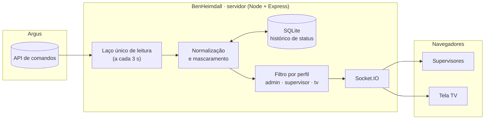

- **Um único** laço consulta a Argus, não importa quantos navegadores estejam abertos.
- Cada mudança de status vai para o SQLite; dali saem o total de pausa do dia, os atendimentos e a
  linha do tempo, que sobrevivem a reinícios.
- No navegador, os cronômetros correm a cada segundo, corrigidos pela hora do servidor.

<details>
<summary><b>📁 Pastas, tecnologias e API</b></summary>
<br />

```text
BenHeimdall/
├─ apps/
│  ├─ server/            Node · Express · Socket.IO · SQLite · Zod · pino
│  │  └─ src/            leitura/ · acesso/ · rotas/ · projecao.ts · socket.ts
│  └─ web/               React 18 · Vite · Tailwind CSS · TanStack Query · React Router
├─ packages/
│  ├─ shared/            tipos, schemas Zod e regras de exibição
│  └─ argus-client/      cliente da Argus (real e simulado), independente do resto
├─ config/               pausas.json · equipes.json
├─ scripts/windows/      serviço do Windows, vigia e túnel
├─ docs/                 protótipo aprovado e imagens deste README
├─ ecosystem.config.cjs  PM2
└─ Dockerfile · docker-compose.yml
```

**Front:** o sistema de design (cores do tema claro e escuro, fontes, sombras e animações) fica
em [`tailwind.config.ts`](apps/web/tailwind.config.ts), e os componentes de tela em `@layer components`
com `@apply`, em [`index.css`](apps/web/src/index.css). As animações respeitam `prefers-reduced-motion`.

| Rota                                                                                                       | Acesso                         | Para quê                                  |
| ---------------------------------------------------------------------------------------------------------- | ------------------------------ | ----------------------------------------- |
| `GET /health` · `GET /api/saude`                                                                           | público                        | Conexão com a Argus e com o banco         |
| `POST /api/sessao/entrar`                                                                                  | público                        | Login                                     |
| `GET /api/sessao` · `POST /api/sessao/(renovar\|sair\|trocar-senha)`                                       | sessão                         | Sessão atual                              |
| `GET /api/painel`                                                                                          | sessão                         | Fotografia atual, já filtrada pelo perfil |
| `GET /api/agentes/:id`                                                                                     | admin, supervisor              | Linha do tempo e pausa do dia             |
| `GET/POST /api/usuarios` · `POST /api/usuarios/:id/(desativar\|reativar\|nova-senha)` · `GET /api/acessos` | admin                          | Contas e log                              |
| `POST /api/dev/argus/(queda\|restaurar)`                                                                   | só simulação, fora de produção | Simular queda da Argus                    |
| Socket.IO `painel:atualizado`                                                                              | sessão                         | Atualização a cada ciclo                  |

</details>

<details>
<summary><b>🧭 Decisões tomadas</b></summary>
<br />

**Visual**

1. Fontes **Space Grotesk** (títulos e números), **Inter** (texto) e **JetBrains Mono** (código e
   telefone), servidas pelo próprio app, para a TV funcionar sem internet.
2. Tema segue o sistema (escuro ou claro). As animações desligam com `prefers-reduced-motion`.
3. CSS com **Tailwind**: sistema de design no `tailwind.config.ts`, componentes com `@apply` e `clsx`.

**Dados e painel**

4. Status desconhecido da Argus vira Offline e aparece uma vez no log.
5. Os indicadores contam os agentes do filtro atual. Fila de espera e callbacks saíram da tela (a API da Argus também não os tem).
6. O "dia" começa à meia-noite no fuso do servidor; configure `TZ=America/Sao_Paulo` se ele estiver em UTC.
7. O histórico começa quando o BenHeimdall começa a ler: não há carga retroativa do dia.
8. A ordem dos livres fica salva no navegador. O mapa mostra o salão inteiro e esmaece quem está fora do filtro.

**Acesso**

9. "Uso" da sessão é interação do usuário (clique, tecla, mouse, rolagem); leituras automáticas não renovam.
10. Senha errada mostra mensagem genérica, sem revelar se a conta existe.
11. A senha temporária tem 10 caracteres sem ambiguidade e aparece uma única vez para o admin.
12. `/health` é público e não expõe dados de agentes.

**Execução e rede**

13. Em produção, o backend serve o front (mesma origem do cookie); em dev, o Vite faz proxy.
14. **npm** com workspaces e PM2 no projeto, no mesmo padrão de comandos do BenURA; o backend de
    produção é um bundle do esbuild.
15. Cloudflare **Tunnel**, não Pages/Workers. `TRUST_PROXY=loopback` por padrão, para ninguém
    forjar o IP pelo `X-Forwarded-For`.
16. O `.env` é lido pelo backend sem sobrescrever variáveis do sistema; dentro do arquivo, vale a
    última ocorrência (como no dotenv).

</details>

## 📌 O que ainda falta

- [ ] **Vendas do dia e conversão:** a venda é uma tabulação, e o relatório de tabulações não
      está detalhado na documentação da Argus. Até lá, a conversão mostra 0%; use "Mais ocioso primeiro".
- [ ] **IP da Tela TV** em `TV_ALLOWED_IPS`.
- [ ] **Primeira leitura com a Argus real:** conferir no log se algum texto de status ficou de fora (por exemplo, o de pós-atendimento).

<div align="center">
<br />
<sub>Feito para a operação da <b>Benconsig</b> · os dados das imagens são fictícios (modo simulado).</sub>
</div>
